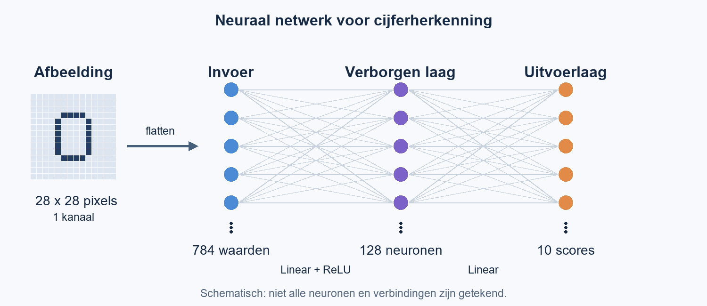

# Handgeschreven cijfers herkennen

Een leerproject dat met PyTorch handgeschreven cijfers van 0 tot en met 9 leert herkennen. Het netwerk wordt getraind op MNIST. Met een eenvoudig tekenvenster kun je daarna zelf een cijfer tekenen en een voorspelling bekijken.

## Installeren en starten

Je hebt Python 3 en een werkende Tkinter-installatie nodig (Tkinter wordt doorgaans met Python meegeleverd). De code is lokaal getest met Python 3.12. Maak vanuit deze map een virtuele omgeving en installeer de pakketten:

```powershell
python -m venv .venv
.\.venv\Scripts\Activate.ps1
python -m pip install -r requirements.txt
```

Op macOS of Linux activeer je de omgeving met `source .venv/bin/activate`. De MNIST-data wordt meegeleverd in `data/`. Als de bestanden ontbreken, probeert het programma ze automatisch te downloaden; daarvoor is een internetverbinding nodig.

```bash
python main.py
```

Dit laadt het checkpoint met het hoogste batchnummer uit `models/`, als er een is, traint één extra ronde over de trainingsset en meet daarna de nauwkeurigheid op de testset. Zonder checkpoint begint het netwerk met willekeurige gewichten. Tijdens de training verschijnen de batch en loss in de terminal; iedere 500 batches en aan het einde wordt een checkpoint opgeslagen. Een ronde duurt 1.875 batches bij 60.000 voorbeelden en batchgrootte 32. De benodigde tijd hangt af van je computer.

```bash
python spelen.py
```

Teken met de muis één cijfer en klik op **Voorspel**. Met **Wis** maak je het tekenvlak leeg. Hiervoor is een checkpoint in `models/` nodig. Een voorspelling is een schatting en kan verkeerd zijn, vooral als een tekening afwijkt van de MNIST-voorbeelden.

## Hoe werkt `main.py`?

### Gegevens voorbereiden

`make_loaders()` haalt de trainings- en testgegevens van MNIST op als ze nog niet lokaal aanwezig zijn. MNIST bevat 60.000 trainingsafbeeldingen en 10.000 testafbeeldingen van handgeschreven cijfers. Elke afbeelding is 28 × 28 pixels in grijstinten en heeft een label van 0 tot en met 9.

`transforms.ToTensor()` zet elke afbeelding om in een tensor met pixelwaarden tussen 0 en 1. Een `DataLoader` groepeert afbeeldingen en labels in batches van 32. De trainingsdata wordt geschud, de testdata niet. De dataset wordt pas geladen wanneer `run_model()` wordt uitgevoerd; alleen het model importeren voor het tekenvenster downloadt niets.

### Het neurale netwerk



De afbeelding is schematisch: de puntjes staan voor de neuronen die niet afzonderlijk zijn getekend. Elke laag is volledig verbonden met de volgende laag.

`NeuralNetwork` is een PyTorch `nn.Module` met twee volledig verbonden lagen:

1. `torch.flatten` verandert iedere afbeelding van 28 × 28 in een rij van 784 pixelwaarden. De batchdimensie blijft behouden.
2. `layer1` berekent uit die 784 waarden 128 nieuwe waarden. `ReLU` zet negatieve waarden op nul en voegt niet-lineariteit toe.
3. `layer2` zet de 128 waarden om in tien scores, één per cijfer. Dit zijn ongecalibreerde scores (logits), geen percentages.
4. `choose_output()` kiest met `argmax` de index van de hoogste score als voorspeld cijfer.

De lagen hebben gewichten en biases. Het leren bestaat uit het aanpassen van deze parameters zodat de score voor het juiste cijfer doorgaans hoger wordt.

### Trainen

`init_model()` maakt het netwerk, `CrossEntropyLoss` en de Adam-optimizer met een learning rate van 0,001. Cross-entropy vergelijkt de tien logits met het juiste label. Een lagere loss betekent voor die batch doorgaans dat de voorspellingen beter aansluiten bij de labels.

Voor elke batch voert `train()` deze stappen uit:

1. `optimizer.zero_grad()` wist de gradiënten van de vorige batch.
2. Het netwerk berekent scores; de lossfunctie vergelijkt ze met de labels.
3. `loss.backward()` berekent via backpropagation hoe de parameters de loss beïnvloeden.
4. `optimizer.step()` past de parameters aan met Adam.
5. De teller loopt op en iedere 500 batches worden de gewichten opgeslagen.

Een volledige doorgang door de trainingsset heet een epoch. `run_model()` traint per aanroep één epoch. Checkpoints bevatten alleen de modelgewichten, geen optimizerstatus of positie in de dataset. Bij hervatten begint daarom een nieuwe epoch met een nieuwe Adam-optimizer; het batchnummer loopt wel door. De checkpoints zijn periodieke momentopnamen, niet noodzakelijk de modellen met de beste testscore.

### Opslaan, laden en evalueren

`load_existing_modell()` zoekt naar bestanden met de naam `number_recognition_<batch>.pt` en laadt het bestand met het hoogste numerieke batchnummer. De paden voor data en modellen zijn gebaseerd op de locatie van `main.py`, zodat ze niet afhangen van de huidige werkmap. Gebruik alleen vertrouwde checkpointbestanden.

`evaluate()` zet het model in evaluatiemodus en schakelt gradiëntberekening uit. Vervolgens vergelijkt het de voorspelling van elk testvoorbeeld met het juiste label en drukt het percentage correcte voorspellingen af. De testset wordt niet gebruikt om de gewichten bij te stellen. `predict()` gebruikt dezelfde aanpak voor een losse batch afbeeldingen.

Je kunt `run_model()` ook vanuit Python aanroepen en met de argumenten training, evaluatie, het laden van gewichten en het opslaan van checkpoints aan- of uitzetten. Voor een nieuwe training zonder bestaande gewichten gebruik je bijvoorbeeld `run_model(load_existing_model=False)`. Let op: bestaande checkpoints met dezelfde batchnummers kunnen dan worden overschreven.

## Overige bestanden

- `spelen.py` laadt het nieuwste checkpoint en verbindt het netwerk met het tekenvenster.
- `tekenvlak.py` bevat de met ChatGPT gemaakte visualisatie. Het venster maakt van de tekening een grijswaardenafbeelding, snijdt de lege ruimte weg, schaalt het cijfer naar maximaal 20 × 20 pixels en centreert het op een zwart vlak van 28 × 28 pixels. Daarna gaat de tensor naar het model.
- `models/` bevat opgeslagen modelgewichten. `data/` bevat lokaal gedownloade MNIST-bestanden.

## NOTE

Het README.md bestand is volledig gegenereert door middel van ChatGPT om de werking te kunnen beschrijven. Ook het bestand tekenvlak.py is door ChatGPT gegenereerd.